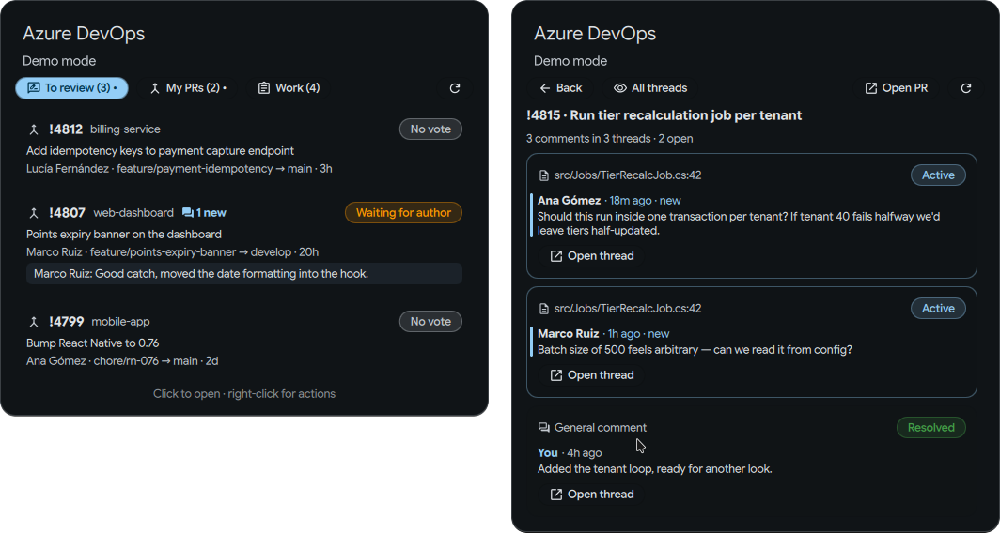

# Azure DevOps for Dux Shell

A DankBar widget for Azure DevOps: pull requests waiting on your review, your
own pull requests, and work items assigned to you.



## Features

- **Bar pill** — number of PRs waiting on your vote, plus assigned work items.
  Right-click it to refresh now.
- **To review** tab — active PRs where you're a reviewer (excluding your own),
  with your current vote. Right-click a row to vote (Approve, Approve with
  suggestions, Wait for author, Reject, Reset), comment (Markdown), copy the
  link or the source branch.
- **My PRs** tab — your active PRs with a reviewer summary
  (`2/3 approved`, `1 waiting`, `1 rejected`).
- **Work** tab — work items assigned to you that aren't closed. Right-click to
  change state (lists the states valid for that work item type), comment, copy
  `#id`, or copy a branch name such as `feature/1290-recalculate-customer-tiers`.
- **PR comments** — each PR row shows its open thread count; new comments from
  others show as "N new" with a preview of the latest one, and the bar pill
  gets an unread counter. Right-click → **Discussion** (or click the
  new-comment preview) opens the full conversation: every thread with all its
  comments, formatted, with file and line, status, and new comments marked.
  Toggle between all threads and open ones only; "Open thread" jumps to it in
  the browser. Opening the PR or its discussion marks
  it read. On PRs you review, replies in threads you've posted in count too.
- Left-click any row to open it in the browser.
- Notifications for new review requests, votes and comments on your PRs,
  replies on PRs you review, and (optionally) newly assigned work items.
- Results and unread state are saved to `~/.local/state/dms/plugins/`, so the
  bar fills immediately on startup and comments that arrived while you were
  logged out still notify.
- With a bar on several screens, only one instance polls, so nothing notifies
  twice.
- Demo mode with fake data for trying the UI without a token.

## Installing

From Dux Shell: Settings → Plugins → Browse, search for "Azure DevOps".

Or manually:

```sh
git clone https://github.com/EduardoRodaRoca/dux-azure-devops ~/.config/dms/plugins/azureDevOps
dms restart
```

Then enable it under Settings → Plugins and add it to your bar.

## Setup

1. Create a Personal Access Token at
   `https://dev.azure.com/<org>/_usersSettings/tokens` with these scopes:
   - **Code**: Read & write (list PRs, vote, comment)
   - **Work Items**: Read & write (query, change state, comment)
2. Save it to a file only you can read:

   ```sh
   install -m 600 /dev/null ~/.config/dms/ado-token
   $EDITOR ~/.config/dms/ado-token
   ```

   Or keep it in your keyring instead:

   ```sh
   secret-tool store --label='dms-azure-devops' service dms-azure-devops account <org-name>
   ```

3. Settings → Plugins → Azure DevOps: set the organization URL
   (`https://dev.azure.com/<org>`) and the token file path (absolute).
4. Optionally limit to specific projects (comma-separated) and adjust the list
   of "done" states for your process template.

Azure DevOps Server (on-prem) works too: use the collection URL, e.g.
`https://tfs.example.com/tfs/DefaultCollection` (needs API version 7.1, i.e.
Azure DevOps Server 2022+).

## Requirements

- Dux Shell (DMS) 2.0 or newer. Copying and notifications use the built-in
  `dms cl copy` and `dms notify`.
- `libsecret` (`secret-tool`) only if you keep the token in a keyring.

## Development

Edit the files in place, then:

```sh
dms ipc call plugin-scan reload azureDevOps
```

Reload only refreshes `AzureDevOps.qml`; after editing `AdoClient.qml` run
`dms restart`. Note that DMS doesn't pick up hand edits to `plugin_settings.json` while
running; change settings through the Settings UI.

## Files

- `AzureDevOps.qml` — bar pill, popout, rows, polling, notifications
- `AdoClient.qml` — REST client (PRs, votes, threads, WIQL, work item updates)
- `AzureDevOpsSettings.qml` — settings page
